# TaskMate - Student Task Tracker

Tugas Web Programming (S1 Rekayasa Perangkat Lunak)  
Nama: Mikdam Huda  
NIM: 1302223034  

---

## Deskripsi Aplikasi
TaskMate adalah aplikasi web pencatatan dan pengelolaan tugas perkuliahan. Aplikasi ini membantu mahasiswa mengorganisir daftar tugas, memantau tenggat waktu (deadline), serta memperbarui status pengerjaan secara interaktif di sisi klien (client-side).

Aplikasi ini dibangun menggunakan HTML semantic, CSS native (`style.css`), Bootstrap 5, JavaScript murni, dan library jQuery.

---

## Teknologi yang Digunakan
1. **HTML5**: Struktur halaman semantik (`<header>`, `<nav>`, `<main>`, `<article>`, `<aside>`, `<footer>`, `<form>`, `<table>`).
2. **CSS3 Native (`style.css`)**: Tata warna, tipografi, badge prioritas/status, efek interaksi klik, serta media query untuk tampilan responsif.
3. **Bootstrap 5**: Tata letak grid (`container`, `row`, `col`), navigasi navbar, komponen tabel responsif, formulir, dan kartu informasi.
4. **JavaScript Murni**:
   - Penyimpanan data dummy berbasis array of objects (`DATA_AWAL`).
   - Fungsi pemrosesan data: `hitungStatistik()` untuk rekapitulasi jumlah tugas dan `filterDataTugas()` untuk penyaringan data.
   - Struktur perulangan (`for`) dan percabangan (`if-else`) pada fungsi `renderTabel()` untuk membuat baris tabel secara dinamis ke elemen DOM.
5. **jQuery**:
   - Efek animasi dan tampilan: `slideToggle()` untuk panel filter dan daftar sub-tugas, `fadeIn()` dan `fadeOut()` untuk banner notifikasi.
   - Event handling: event `.on('click')` untuk tombol aksi (filter, hapus data, reset) dan event `.on('submit')` untuk validasi field formulir.

---

## Struktur Halaman
1. `index.html`: Dashboard ringkasan jumlah status tugas, filter status, tabel daftar tugas dinamis, dan aksi hapus data.
2. `tambah-tugas.html`: Formulir penambahan tugas baru dengan validasi field wajib dan feedback alert interaktif.
3. `detail-tugas.html`: Rincian deskripsi tugas, checklist sub-tugas interaktif, dan panel informasi metadata.

---

## Petunjuk Pengambilan Video Demonstrasi
Video demonstrasi interaktivitas berdurasi sekitar 1 hingga 2 menit. Berikut langkah-langkah yang perlu direkam:

1. **Dashboard dan Render Dinamis (`index.html`)**:
   - Tampilkan dashboard, jelaskan secara singkat bahwa 4 kotak rekapitulasi statistik dan isi tabel di-render otomatis dari JavaScript menggunakan array data dummy.
2. **Efek Animasi dan Filter Data (jQuery `slideToggle` & Event Click)**:
   - Klik tombol "Filter Tugas" untuk menampilkan panel filter yang terbuka dengan animasi turun (`slideToggle`).
   - Klik tombol status seperti "Sedang Dikerjakan" atau "Selesai" untuk memperlihatkan tabel yang otomatis tersaring sesuai status.
   - Klik tombol "Semua" untuk mengembalikan tampilan seluruh data.
3. **Aksi Hapus dan Notifikasi (jQuery `fadeOut`, `fadeIn`, & Manipulasi Data)**:
   - Klik tombol "Hapus" pada salah satu baris tugas.
   - Tunjukkan baris tugas yang menghilang dengan efek `fadeOut`, kartu statistik yang otomatis berkurang angkanya, dan banner notifikasi hijau yang muncul (`fadeIn`).
4. **Validasi Formulir (`tambah-tugas.html`)**:
   - Masuk ke menu "Tambah Tugas".
   - Langsung klik tombol "Simpan" tanpa mengisi field untuk mendemonstrasikan validasi jQuery (muncul alert merah "Mohon isi seluruh bidang wajib formulir").
   - Isi seluruh formulir tugas baru secara lengkap, lalu klik "Simpan" untuk memperlihatkan alert sukses hijau.
5. **Pengecekan Data Baru (`index.html`)**:
   - Buka kembali menu "Daftar Tugas", perlihatkan data yang baru ditambahkan sudah masuk ke tabel dan angka total tugas bertambah.
6. **Interaktivitas Detail Tugas (`detail-tugas.html`)**:
   - Buka salah satu halaman detail tugas.
   - Klik butir-butir sub-tugas untuk menandai sub-tugas telah selesai (efek coret / strikethrough).
   - Klik tombol "Sembunyikan Sub-Tugas" untuk mendemonstrasikan penutupan daftar dengan efek animasi `slideToggle`.

---

## Bukti Screenshot Interaktivitas (Sebelum dan Sesudah)

### 1. Interaktivitas Filter Tugas (Efek slideToggle dan Penyaringan Data)
- **Sebelum Interaksi (Panel Filter Tertutup, Semua Data Tampil)**:  
  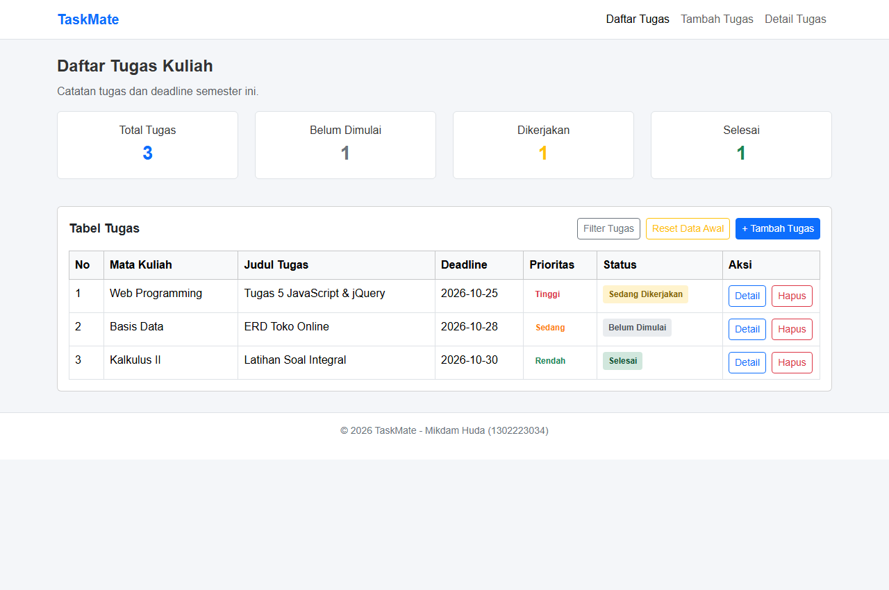

- **Sesudah Interaksi (Panel Filter Terbuka via slideToggle, Data Terfilter Status 'Sedang Dikerjakan')**:  
  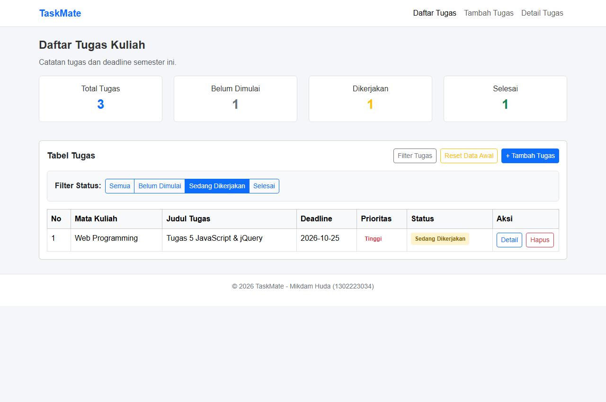

---

### 2. Interaktivitas Hapus Data (Efek fadeOut, Perhitungan Ulang Statistik, dan Notifikasi)
- **Sebelum Interaksi (Terdapat 3 Tugas, Tombol Hapus Tersedia)**:  
  

- **Sesudah Interaksi (Baris Dihapus via fadeOut, Total Tugas Berubah Menjadi 2, Notifikasi Muncul)**:  
  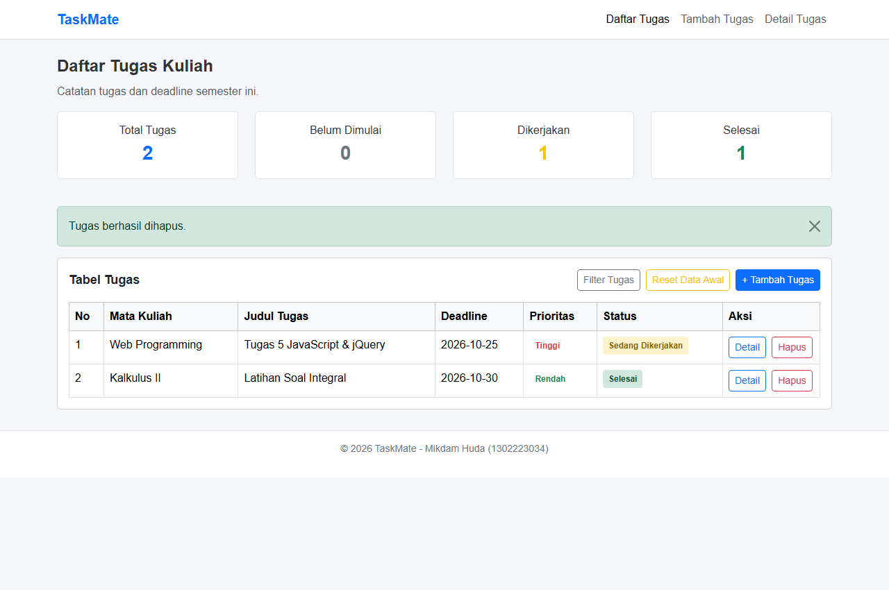

---

### 3. Validasi Form Tambah Tugas (jQuery on submit dan slideDown Error)
- **Sebelum Validasi (Formulir Masih Kosong)**:  
  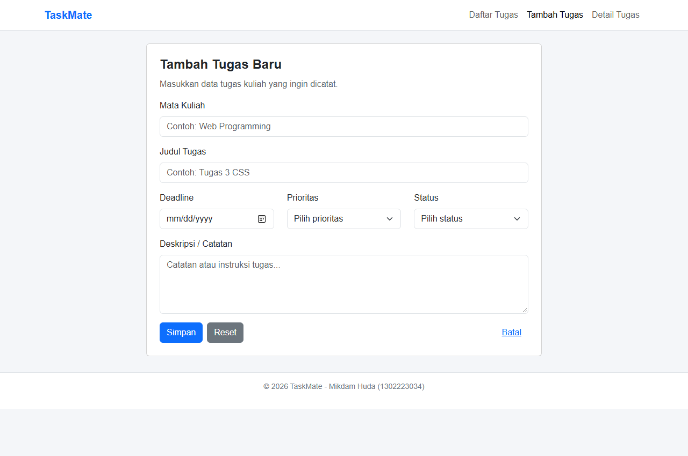

- **Sesudah Validasi (Pesan Peringatan Muncul Akibat Field Kosong)**:  
  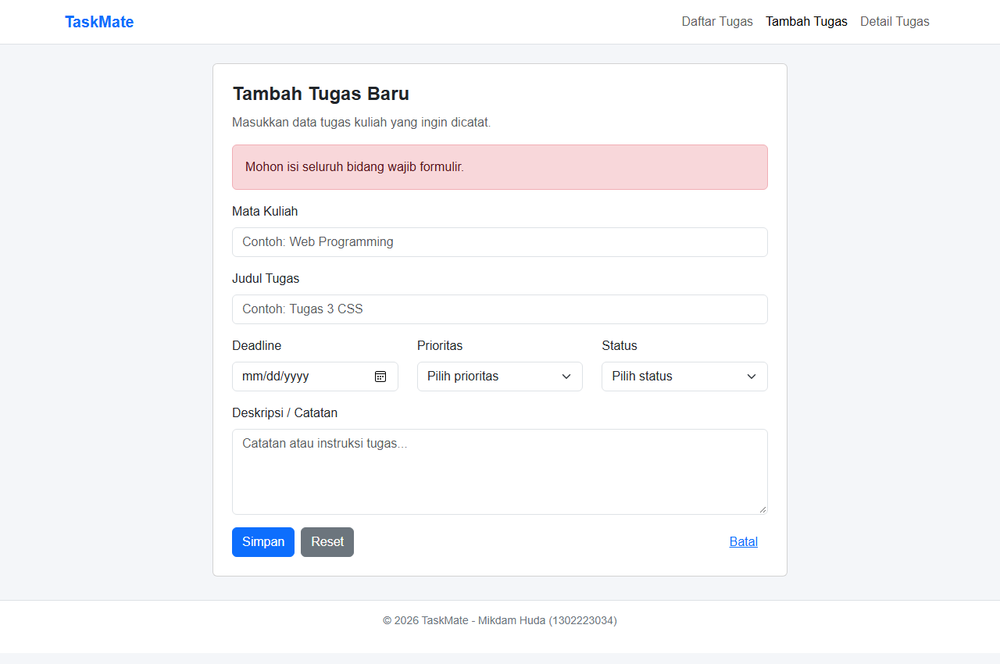

- **Sesudah Form Berhasil Disimpan (Notifikasi Sukses Muncul via fadeIn)**:  
  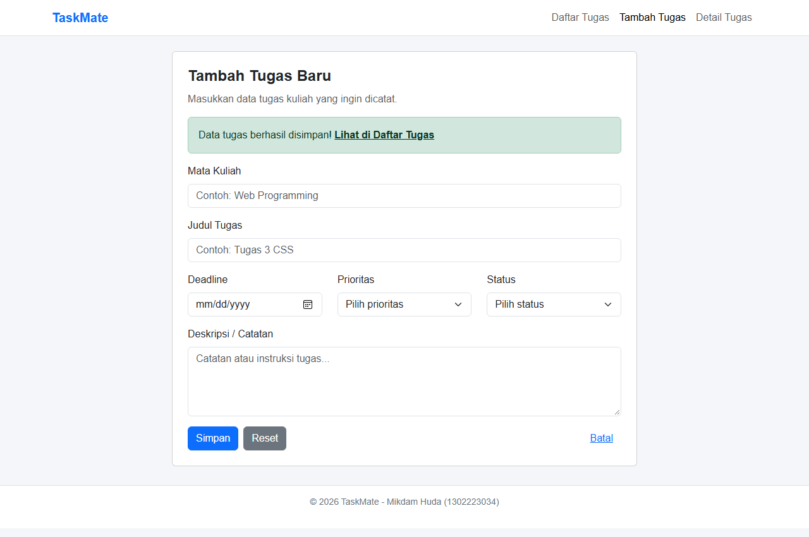

---

### 4. Interaktivitas Halaman Detail (Checklist dan Sembunyikan Sub-Tugas)
- **Sebelum Interaksi (Daftar Sub-Tugas Standar)**:  
  

- **Sesudah Interaksi Sub-Tugas Tercoret (Selesai)**:  
  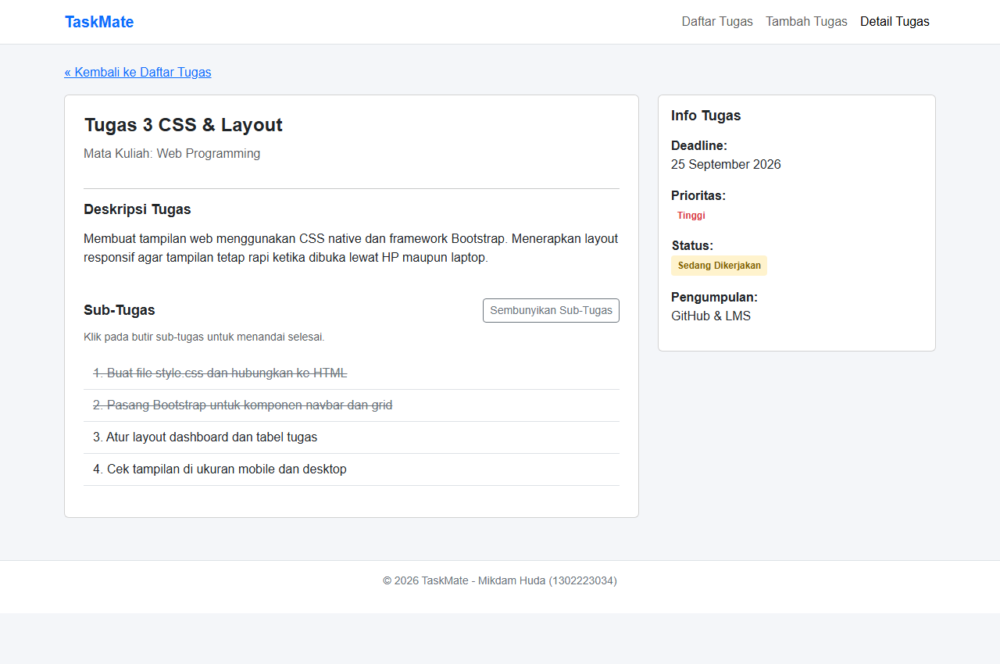

- **Sesudah Interaksi Sub-Tugas Disembunyikan (slideToggle)**:  
  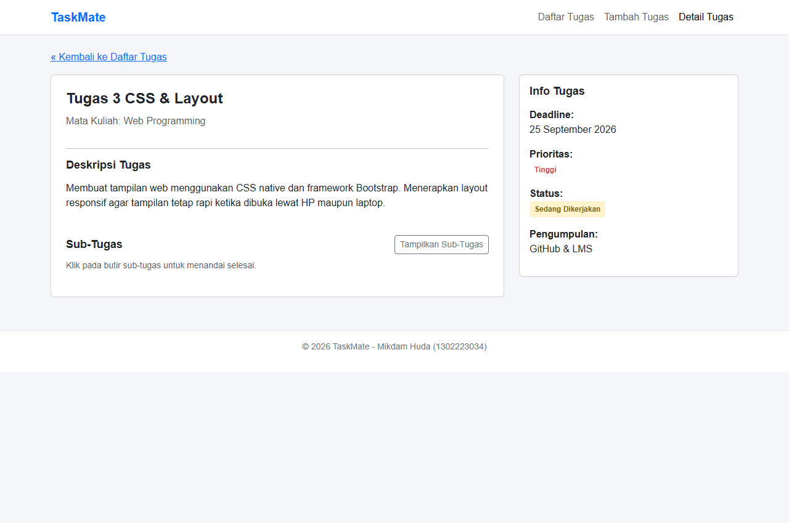

---

## Screenshot Tampilan Utama

### Tampilan Desktop
1. **Dashboard (`index.html`)**  
   

2. **Form Tambah Tugas (`tambah-tugas.html`)**  
   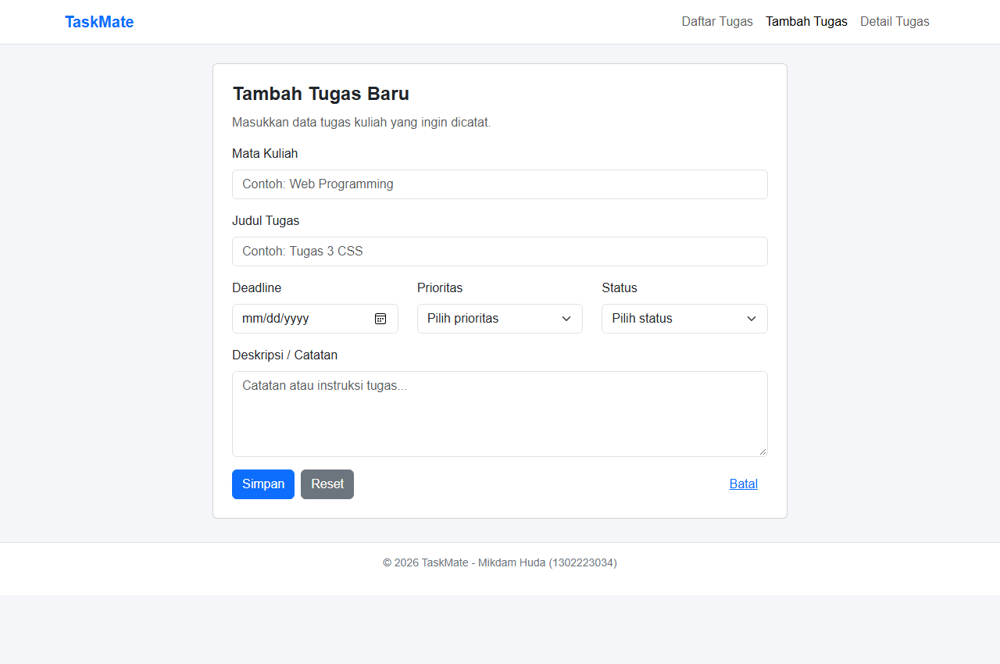

3. **Detail Tugas (`detail-tugas.html`)**  
   

### Tampilan Mobile
1. **Dashboard Mobile**  
   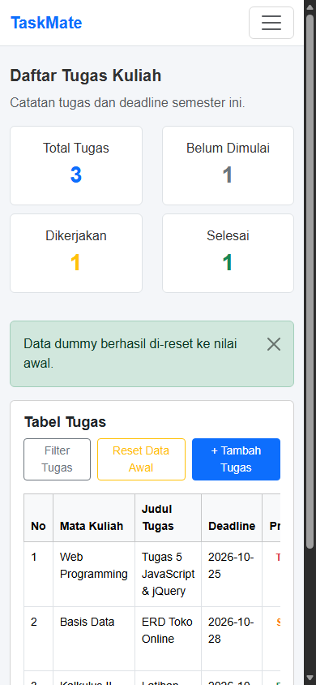

2. **Form Tambah Tugas Mobile**  
   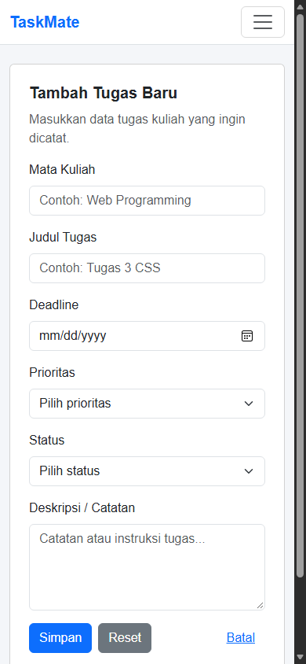

3. **Detail Tugas Mobile**  
   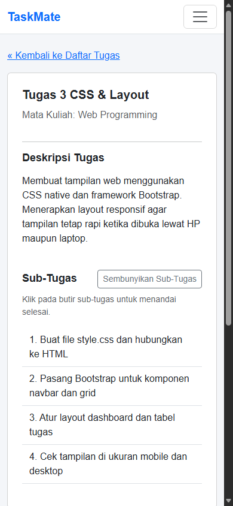
