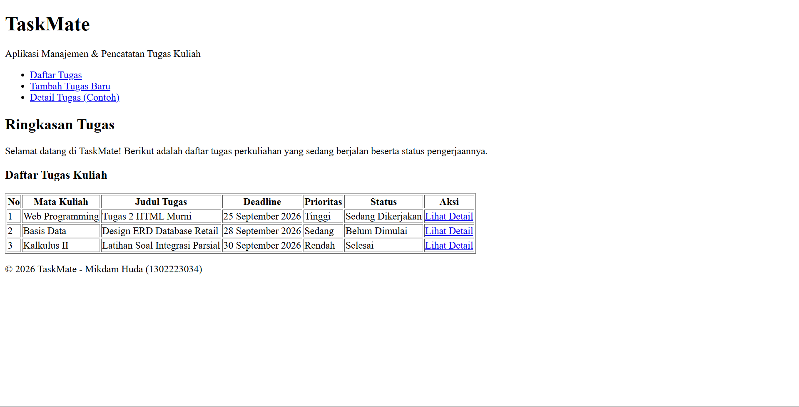
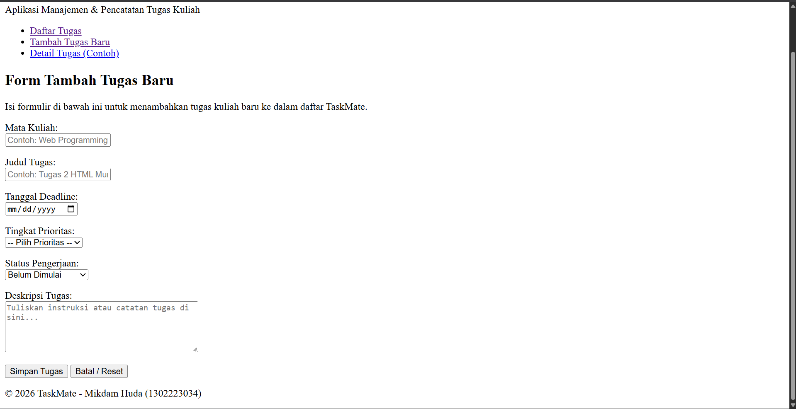
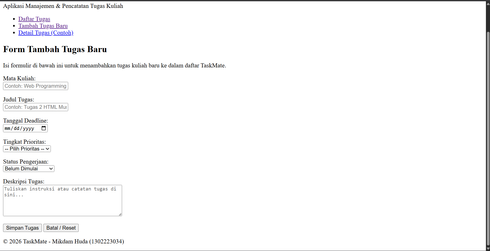

# Tugas Besar - Struktur HTML Murni (TaskMate)

**Mata Kuliah:** Web Programming  
**Mahasiswa:** Mikdam Huda  
**NIM:** 1302223034  
**Topik Aplikasi:** TaskMate (Student Task Tracker)  

---

## Deskripsi Proyek
Proyek ini merupakan tahap pertama (pembentukan struktur HTML murni tanpa CSS / Framework) dari aplikasi fullstack **TaskMate**. 

Aplikasi terdiri dari 3 halaman HTML utama:
1. `index.html` - Halaman Utama / Daftar Tugas & Ringkasan
2. `tambah-tugas.html` - Form Tambah Data Tugas Baru
3. `detail-tugas.html` - Halaman Detail Informasi Spesifik Tugas

---

## Struktur Semantic HTML5 & Aksesibilitas
- **Semantic Tags:** Menggunakan `<header>`, `<nav>`, `<main>`, `<article>`, dan `<footer>` pada seluruh halaman.
- **Form & Label Accessibility:** Setiap elemen `<input>`, `<select>`, dan `<textarea>` pada `tambah-tugas.html` menggunakan `<label for="...">` yang terhubung secara eksplisit dengan `id`.
- **Image Accessibility:** Atribut `alt` deskriptif diberikan pada tag `` di halaman `detail-tugas.html`.
- **Tabel Data:** Halaman `index.html` dan `detail-tugas.html` memuat elemen `<table>`, `<thead>`, `<tbody>`, `<th>`, dan `<td>`.

---

## Tampilan Halaman (Screenshots)

1. **Halaman Utama (`index.html`)**
   

2. **Form Tambah Tugas (`tambah-tugas.html`)**
   

3. **Detail Tugas (`detail-tugas.html`)**
   
